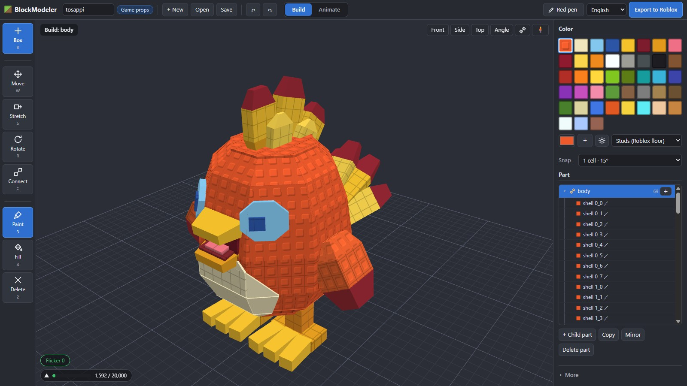
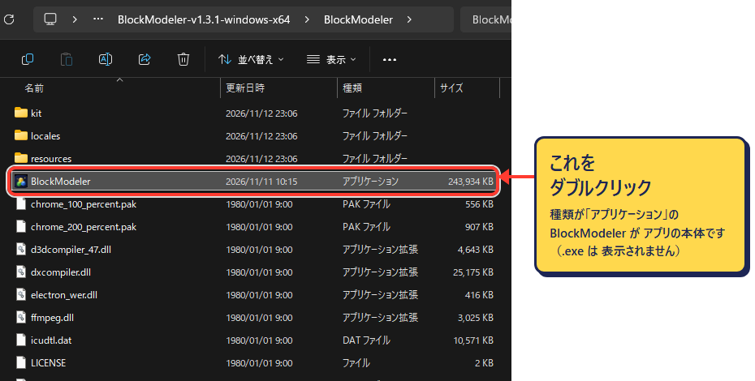

# BlockModeler / ブロックモデラー

Roblox に入れるためのカクカクした 3D モデルを、ブロックを組み合わせて作る無料のツールです。
A free tool for building low-poly, blocky 3D models from boxes, made for Roblox creators.

> **いまはベータ版です。** うまく動かない所があれば、[紹介ページのお問い合わせ](https://hajimete.myvoxels.com/creators/blockmodeler/#contact) から教えてください。
>
> **This is a beta.** If something does not work, please tell me through the [contact form](https://hajimete.myvoxels.com/creators/blockmodeler/#contact).



## 使い方 / Get it

- **Windows アプリ**：[Releases](https://github.com/shack8888/BlockModeler-app/releases/latest) から zip をダウンロードし、zip を右クリックして「すべて展開」を選びます。できたフォルダの中の `BlockModeler` フォルダを開き、種類が「アプリケーション」の `BlockModeler` をダブルクリックします（名前の .exe は ふつう表示されません）。インストールは要りません。ネットなしで動きます。AI がなくても、アプリはこれで開けます。



動作を確かめたのは Windows だけです。アプリには電子署名がないため、はじめて開く時に Windows の警告が出ることがあります。その時は「詳細情報」から「実行」を選んでください。

展開から開くまでを AI（Claude Code など）に頼む時は、次の文を貼ります。

```
ブロックモデラーを開けるようにしてください。

1. ダウンロード フォルダにある BlockModeler-v で始まる zip（いちばん新しい物）を、同じ場所に展開してください。
2. 展開したフォルダの中の BlockModeler フォルダにある BlockModeler.exe を開いてください。
3. 次からすぐ開けるように、デスクトップに BlockModeler.exe のショートカットを作ってください。
4. 開けなかった時は、出た窓や文をもとに、何が起きているかと、次に何をすればいいかを短く教えてください。
```

- **Windows app**: download the zip from [Releases](https://github.com/shack8888/BlockModeler-app/releases/latest), right-click it and choose "Extract All". Open the `BlockModeler` folder inside, then double-click `BlockModeler`, the file whose type is "Application" (Windows usually hides the .exe part of the name). No install, works offline, and it opens without any AI.

It has only been tested on Windows. The app is not code-signed, so Windows may show a warning the first time. Choose "More info", then "Run anyway".

To have an AI such as Claude Code unzip and open it for you, paste this:

```
Please get BlockModeler ready to open.

1. In my Downloads folder, unzip the newest zip whose name starts with BlockModeler-v into the same place.
2. Open BlockModeler.exe in the BlockModeler folder inside the unzipped folder.
3. Make a desktop shortcut to BlockModeler.exe so I can open it quickly next time.
4. If it does not open, tell me briefly what happened and what to do next, based on the window or message that appeared.
```

画面の言葉：日本語・English・Español・Português・한국어・简体中文（右上で切りかえ）。日本語以外は AI の翻訳なので、直した方がよい言葉があれば [紹介ページのお問い合わせ](https://hajimete.myvoxels.com/creators/blockmodeler/#contact) で教えてください。

Screen languages: Japanese, English, Spanish, Portuguese, Korean and Simplified Chinese (choose at the top right). Everything except Japanese was translated by AI, so please use the [contact form](https://hajimete.myvoxels.com/creators/blockmodeler/#contact) if a word reads wrong.

## はじめての 5 分 / Your first 5 minutes

1. 最初の窓で「ゲームの小物」を選びます。右ドラッグで視点を回し、ホイールで近づけます。矢印キーでも動かせます（← → で回す・↑ ↓ で近づく／はなれる・Shift＋矢印でずらす）。
2. 「のばす」でブロックの面の色つきのつまみを引いて、形を作ります。「回す」で傾けられます。
3. 左上の青い「＋ ブロック」でブロックを足します。右の「形」でピラミッドや六角柱に変えられます。
4. 「ぬる」と「バケツ」で色を付けます。色は右から選びます。
5. 動かしたいブロックを選んで「＋ ブロックをグループに」を押すと、グループに分かれます。右の一覧で親子を確かめて、行をドラッグすると親を変えられます。選んだグループと一緒に動く子は黄色になります。
6. 上の「動き」を開いて、グループを選び、輪を回して「再生」を押します。
7. 右上の「Roblox へ書き出す」で `.fbx` を作り、Studio の「3D をインポート」で入れます。

Choose "Game props" in the first window. Right-drag turns the view and the wheel zooms; the arrow keys work too (← → turn, ↑ ↓ zoom, Shift+arrows pan). Use "Stretch" to pull the colored handles and "Rotate" to tilt. The blue "Box" button at the top left adds a box, and "Shape" on the right changes its shape. Color it with "Paint" and "Fill". To make a piece movable, select it and press "+ Box to group"; the list on the right shows the parent-child tree, and dragging a row changes its parent. Then open "Animate", pick a group, turn the ring and press "Play". Finally, "Export to Roblox" makes a `.fbx` for Studio's Import 3D.

## Claude に頼んで作る / Make models by asking Claude

私は普段、モデルを [Claude Code](https://claude.com/claude-code) に言葉で頼んで作り、仕上げだけ自分の手で行っています。やり方は [私の使い方](docs/HOW_I_USE.md) に書きました。

I usually ask [Claude Code](https://claude.com/claude-code) to build models in plain words and only do the finishing by hand. See [How I use it](docs/HOW_I_USE.md).

### AI とつなぐ（MCP） / Connect AI (MCP)

1.4.0 から、開いているアプリの中で Claude Code に直接組んでもらえます。Node.js などを別に入れる必要はありません。

1. 3D の右下の「AI とつなぐ（MCP）」を押してオンにします（ふだんはオフです）。
2. 出てきた案内の「1行を コピー」を押し、Claude Code に貼って Enter を押します（はじめの 1 回だけ。アプリのフォルダを動かした時はもう一度）。
3. Claude Code で新しいチャットを始めて、「ブロックモデラーで 赤いドラゴンを作って」のように頼みます。組む様子がアプリに出ます。
4. オンの間は、スイッチの上の「AI が使う形」で、AI が組む時に使うブロックの形を選べます（形のアイコンを押すたびにオン／オフ。うすい形は使いません）。同じ物でも、選ぶ形でデザインの感じが変わります。自分で置く形はそのままです。

つなぎ口はこの PC の中（127.0.0.1）だけで、オフの間は開きません。

From 1.4.0, Claude Code can build right inside the open app. Nothing else (such as Node.js) needs to be installed.

1. Click "Connect AI (MCP)" at the bottom right of the 3D view to turn it on (it is off by default).
2. In the panel that appears, press "Copy the line", paste it into Claude Code and press Enter (first time only; again if you move the app's folder).
3. Start a new chat in Claude Code and ask something like "Make a red dragon in BlockModeler". You see it being built in the app.
4. While it is on, "Shapes for AI" above the switch lets you choose which block shapes the AI may use (click a shape icon to switch it on or off; faint ones are not used). The same thing gets a different look depending on the shapes. Shapes you place yourself are not limited.

The connection stays inside this PC (127.0.0.1) and is closed while the switch is off.

## できること / What it does

- ブロックを出して、のばす・回す・ななめに置く。グループごとにまとめて骨にする
- グループの親子を木の形で見られる。ドラッグで親を変えられて、一緒に動くグループは色で分かる
- 角のある形 11 種類（四角・くさび・ピラミッド・先細り・三角柱・ひし形・六角柱・八角柱など）
- のばす・大きさは 画面の「きざみ」どおり（1マス・4分の1マス・なめらか＝0.01 マスまで）。Ctrl で 1 マスずつ、Shift でゆっくり
- 面に色をぬる。木の板・レンガ・Roblox の床のぽっちなどの柄は、三角の数を増やさずに描く
- 時間ごとのキーで動きを作り、再生する
- Roblox の三角の上限を見ながら作り、`.fbx` で書き出す（骨と動きも入る）。GLB ビューアや Blender 用の `.glb` も出せる。小物・R15 キャラ・UGC アクセサリーに対応
- 色を光らせる（色の ☀）。Roblox でも光る所として入る
- ななめに置いたブロックからも「つなぐ」でまっすぐのばして、R で曲げられる
- 面が重なってちらつく所を数えて、左下の「ちらつき」を押すと直る
- `.blockmodel` で保存する。グループ・骨・動き・色・柄がそのまま残る
- 「参考の絵」：作りたい物の絵（前・横・後ろなど）を 3D の上に落とすか Ctrl+V で貼ると、右下に並び、押すと大きく見られる。絵はモデルのとなりの `<名前>.refs` フォルダに残る。AI とつないでいる時は、AI もその絵を見て組む
- 「AI とつなぐ（MCP）」：Claude Code などの AI が、開いているアプリのモデルを直接組む（この PC の中だけ・ふだんはオフ）。AI が使う形も、形のアイコンを押して選べる

In short: place and stretch boxes, use 11 angular shapes, group boxes with bones, see the parent-child tree of groups and change it by dragging, paint faces, add patterns without adding triangles, animate with keyframes, make colors glow (they come into Roblox as emissive), extend and bend boxes with "Link" even from tilted boxes, see and fix flickering faces with one click, and export `.fbx` for Roblox Studio's 3D importer (or `.glb` for GLB viewers and Blender) (props, R15 characters and UGC accessories). Projects are saved as `.blockmodel`. "Reference" keeps pictures of what you want (front, side, back…): drop them onto the 3D view or paste them with Ctrl+V, and they stay in a `<name>.refs` folder next to the model. "Connect AI (MCP)" lets an AI such as Claude Code build in the open app (only inside this PC, off by default), and it looks at your reference pictures too. You can also choose which shapes the AI uses (All / Box only / Box + triangles).

### Roblox に入れる時 / Importing into Roblox

書き出した `.fbx` は、Studio の「3D をインポート」でそのまま入れられます。骨と動きも一緒に入ります。ゲームで動きを使うには、Roblox への動きのアップロードが別に必要です。

Studio は GLB の動きを骨の置き場と合わない形で読むため、Studio には `.fbx` を入れます。GLB ビューアや Blender で見る時は、書き出しの窓の「くわしく」から `.glb` を出してください。中身は同じです。

The exported `.fbx` goes straight into Studio's Import 3D, with its bones and animations. To use an animation in a live game you also need to upload it to Roblox.

Studio's glTF importer reads animations in a way that does not match the bones' resting places, so use the `.fbx` in Studio. For GLB viewers and Blender, export a `.glb` from "More" in the export window. The contents are the same.

## 作り方について / How it was made

開発には AI（Claude）を使っています。コード、画面の言葉の翻訳、テストの多くは、人の指示のもとで AI が書きました。見本のキャラクターの元の絵も AI で描いたものです。操作の流れは [Blockbench](https://www.blockbench.net/) を参考にしています。コードは使っていません。

This tool was developed with AI (Claude): most of the code, the translations and the tests were written by AI under human direction. The sample character's original picture was also drawn with AI. Its way of working was inspired by [Blockbench](https://www.blockbench.net/); no Blockbench code is used.

## サポートについて / Support

無保証で提供します。不具合の報告は歓迎しますが、返事や修正を約束するものではありません。

Provided as is, with no warranty. Bug reports are welcome, but replies and fixes are not guaranteed.

## ライセンス / License

無料で使えます（個人でも仕事でも）。作ったモデルは作った人の物です。ソフトウェア自体の配り直し・販売・改変した物の配布はできません。くわしくは [LICENSE](LICENSE)。

Free to use, for personal and commercial purposes. Models you make are yours. Redistributing, selling, or distributing modified copies of the software is not allowed. See [LICENSE](LICENSE).

見本のキャラクター（`ai/tosappi/`）はマイボクセルのキャラクターです。自分のゲームや作品には使えません。[くわしく](ai/tosappi/LICENSE.md)

The sample character in `ai/tosappi/` belongs to My Voxels Inc., and you cannot use it in your own game or other work. [Details](ai/tosappi/LICENSE.md)

Uses [three.js](https://threejs.org/) and [Electron](https://www.electronjs.org/) (both MIT).

Roblox is a trademark of Roblox Corporation. This project is not affiliated with or endorsed by Roblox Corporation.
