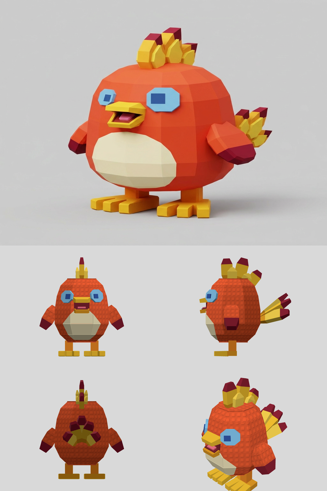

# 私の使い方 / How I use it

私はコードを書きません。作りたいものを Claude Code に言葉で伝えて、できた物を見て直してもらい、細かい所だけ自分の手で触ります。

I do not write code. I tell Claude Code what I want in plain words, look at the result, ask for changes, and touch up the small details by hand.



上が元の絵、下が Claude とこのツールで組んだモデルです。The picture is on top, and the model built with Claude and this tool is below.

## 流れ

1. **絵を用意する**：作りたいキャラの絵を `ai/<名前>/ref.png` に置きます。絵がなければ、Claude に頼んで fal.ai で描いてもらいます。
2. **Claude に頼む**：たとえば次のように伝えます。

   > ai/mychar/ref.png の絵を見て、パーツから組んでください。歩く動きも付けてください。

3. **絵と見くらべる**：Claude が `ai/<名前>/compare.png` を作ります。上が元の絵、下が作ったモデルです。
4. **言葉で直す**：気になった所を、そのまま伝えます。私が実際に頼んだのは、たとえばこんな言葉です。

   - 角を丸めなくていいよ
   - パーツごとに分けて、あとで動かせるようにして
   - 体にだけ、Roblox の床のような凹凸を付けて
   - 元の絵からだいぶ変わったので、絵に忠実にして

   言葉で「どこ」を伝えにくい時は、アプリの **赤ペン** を使います。3D の上に 〇 をかいて「もっと大きく」のように書き、保存すると、モデルのとなりに `<名前>.redpen.json` ができます。Claude に「赤ペン見て」と言えば、〇の下の箱の名前と場所つきで読んで直します。
5. **自分で仕上げる**：アプリの「開く」で `ai/<名前>/<名前>.blockmodel` を開き、形や色、パーツの親子を自分で調整します。「保存」（Ctrl+S）は開いたファイルに上書きします。手で直したあとに Claude に頼む時は、保存してから頼みます。Claude はいちばん新しいファイルから直します。
6. **Roblox に入れる**：アプリの「Roblox へ書き出す」で作った `.fbx` を、Studio の「3D をインポート」で入れます。アプリで手直ししない時は、Claude が作った `ai/<名前>/<名前>.fbx` をそのまま入れられます。`.glb` は GLB ビューアや Blender で見る用です。

## きれいに作るコツ

- **絵をいきなり 3D にしない**：まず AI に「部品ごとの箱で描きなおして。ばらした図も付けて」と頼みます（`tools/ai/edit_sheet.mjs`・fal.ai の料金がかかります）。部品の分け方が、そのままモデルのパーツ分けになります。
- **真横と真正面で測る**：ななめの絵 1 枚から奥行きを当てずっぽうにしません。傾きのない向きの絵で、ます目を数えて組んでもらいます。
- **同じ向きで並べてくらべる**：元の絵とモデルを同じ向きで並べると、ずれがひと目で分かります。
- **直しは赤ペンで**：〇 と ひと言で、どの箱の話かまで伝わります。

## はじめ方

いちばん早い方法は、AI に任せることです。[Claude Code](https://claude.com/claude-code) などの AI を入れて、空のフォルダで開き、次を貼ります。

```
ブロックモデラーを、絵からモデルを組める状態にしてください。

1. https://github.com/shack8888/BlockModeler-app/releases/latest から Windows アプリの zip をダウンロードして、このフォルダに展開してください（BlockModeler フォルダができます）。
2. BlockModeler/kit の CLAUDE.md を読んで、作り方を確認してください。AI 用の道具は kit フォルダの中です。
3. kit フォルダで 見本の node tools/ai/build.mjs tosappi を動かして、できた look.png を見て、組み立てが動くことを確かめてください。
4. Node.js・Chrome が足りなくて進めない時は、入れ方を教えてください。
5. 終わったら、作りたいキャラの絵をどこに置いて、次に何と頼めばいいかを、短く教えてください。
```

自分で進める時は、次の順番です。

1. **アプリを入れる**：[Releases](https://github.com/shack8888/BlockModeler-app/releases/latest) から Windows アプリの zip をダウンロードして展開し、`BlockModeler.exe` を開きます。インストールは要りません。
2. **道具を3つ入れる**：[Claude Code](https://claude.com/claude-code)、[Node.js](https://nodejs.org/)、[Chrome](https://www.google.com/chrome/) です。
3. **AI 用の一式を開く**：zip を展開した `BlockModeler` フォルダの中に `kit` フォルダがあります。そこで PowerShell を開き（フォルダの何もない所で Shift＋右クリック →「PowerShell ウィンドウをここで開く」）、`claude` と打つと Claude Code が始まります。

4. **Claude に頼む**：「ai/mychar/ref.png の絵を見て、パーツから組んでください」のように伝えます。絵は先に `kit` フォルダの中の `ai/mychar/ref.png` に置きます。手順はこのフォルダの `CLAUDE.md` に書いてあるので、Claude はそれを読んで動きます。
5. **アプリで開く**：できた `ai/mychar/mychar.blockmodel` を、アプリの「開く」で開きます。

見本は `ai/tosappi/` です。`node tools/ai/build.mjs tosappi` で同じ物を作れます。見本のキャラクターは作り方を学ぶためのもので、自分のゲームには使えません（[くわしく](../ai/tosappi/LICENSE.md)）。

Codex を使う時は、Claude Code の代わりに Codex を入れてください。このフォルダの `AGENTS.md` から同じ手順を読みます。私はまだ試していません。

Chrome の場所が標準と違う時は、環境変数 `CHROME` に場所を入れてください。

## お金と鍵

- Claude Code の利用には、Anthropic の料金がかかります。
- 絵を fal.ai で描く時だけ、自分の fal.ai の鍵を環境変数 `FAL_KEY` に入れます。料金は fal.ai の利用分です。組み立てだけなら要りません。
- **鍵はファイルに書かないでください。** このリポジトリに鍵は入っていません。

---

## The flow

1. **Prepare a picture**: put it at `ai/<name>/ref.png`. No picture? Ask Claude to draw one with fal.ai.
2. **Ask Claude**, for example:

   > Look at ai/mychar/ref.png and build it from parts. Add a walking animation too.

3. **Compare**: Claude makes `ai/<name>/compare.png`, with the picture on top and the model below.
4. **Ask for changes in plain words**, such as:

   - No need to round the corners
   - Split it into parts so it can move later
   - Put Roblox-style studs on the body only
   - That drifted from the picture, stay faithful to it

   When it is hard to say where in words, use the app's **Red pen**. Circle a spot on the 3D view, write something like "make it bigger" and save. It writes `<name>.redpen.json` next to the model. Tell Claude "check the red pen" and it reads each note with the name of the box under the circle and its position.
5. **Finish by hand**: open `ai/<name>/<name>.blockmodel` with "Open" in the app, then adjust shapes, colors and the part tree. Save (Ctrl+S) writes back to the file you opened. If you edited by hand, save before asking Claude for more changes, so it works from your newest file.
6. **Put it in Roblox**: export a `.fbx` with "Export to Roblox" and bring it in with Studio's Import 3D. If you did not edit it in the app, `ai/<name>/<name>.fbx` from Claude works directly. The `.glb` is for GLB viewers and Blender.

## Tips for a clean model

- **Do not go from the picture straight to 3D**: first ask an AI to "redraw it with one box per part, with an exploded view" (`tools/ai/edit_sheet.mjs`, charged by fal.ai). The way it splits the parts becomes the model's part tree.
- **Measure from straight-on views**: do not guess depth from one angled picture. Have the AI count grid squares on views with no tilt.
- **Compare from the same angle**: put the picture and the model side by side at the same angle, and the differences stand out.
- **Use the red pen for fixes**: a circle and a few words tell the AI exactly which box you mean.

## Getting started

The fastest way is to let the AI do it. Install an AI such as [Claude Code](https://claude.com/claude-code), open it in an empty folder and paste this:

```
Set up BlockModeler so I can build models from pictures.

1. Download the Windows app zip from https://github.com/shack8888/BlockModeler-app/releases/latest and unzip it into this folder (it makes a BlockModeler folder).
2. Read BlockModeler/kit/CLAUDE.md to learn how models are made. The tools for AI are in the kit folder.
3. In the kit folder, run the sample with node tools/ai/build.mjs tosappi, look at the look.png it makes, and check that building works.
4. If Node.js or Chrome is missing and you cannot continue, tell me how to install it.
5. When you finish, tell me briefly where to put my character's picture and what to ask you next.
```

To do it yourself, follow this order.

1. **Get the app**: download the Windows zip from [Releases](https://github.com/shack8888/BlockModeler-app/releases/latest), unzip it and open `BlockModeler.exe`. There is nothing to install.
2. **Install three tools**: [Claude Code](https://claude.com/claude-code), [Node.js](https://nodejs.org/) and [Chrome](https://www.google.com/chrome/).
3. **Open the AI kit**: the unzipped `BlockModeler` folder contains a `kit` folder. Open PowerShell there (Shift + right-click on an empty spot in the folder, then "Open PowerShell window here") and type `claude` to start Claude Code.

4. **Ask Claude**: for example, "Look at ai/mychar/ref.png and build it from parts." Put the picture at `ai/mychar/ref.png` inside the `kit` folder first. Claude reads the steps from `CLAUDE.md` in this folder.
5. **Open it in the app**: open `ai/mychar/mychar.blockmodel` with "Open" in the app.

The sample is in `ai/tosappi/`. Run `node tools/ai/build.mjs tosappi` to build it. The sample character is there to learn from, and you cannot use it in your own game ([details](../ai/tosappi/LICENSE.md)).

To use Codex, install it instead of Claude Code. It finds the same steps through `AGENTS.md` in this folder. I have not tried this yet.

If Chrome is somewhere else, put its location in the `CHROME` environment variable.

## Costs and keys

- Claude Code is charged by Anthropic.
- Only drawing pictures with fal.ai needs your own fal.ai key, in the `FAL_KEY` environment variable, and is charged by fal.ai. Building a model does not.
- **Never write a key into a file.** No keys are stored in this repository.
